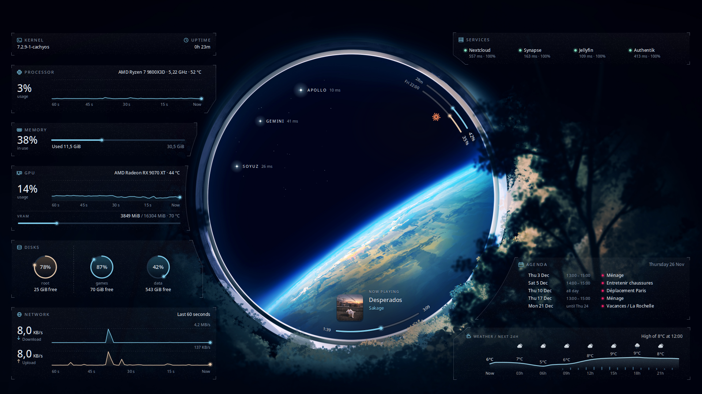

# Conky widgets

A set of [Conky](https://github.com/brndnmtthws/conky) widgets designed around
a spaceship's round window, following the curve of the glass, and the
cards beside it bend around it. Colours come from the wallpaper too.

Everything is drawn with Lua and cairo: Conky's own text output is not used.
Each widget runs as its own Conky instance.



## Widgets

All widgets are placed on the second monitor (HDMI-A-1, 1920×1080).

| Widget | Where | What it shows | Data from |
|---|---|---|---|
| **system** | left side | Kernel and uptime, CPU usage graph, memory, GPU usage and VRAM, disk usage as round gauges, download and upload graphs | `/proc`, `/sys` |
| **claude** | inside the round window, top right | Claude 5-hour and weekly usage limits as two arcs along the glass, with their reset times | `~/.cache/claude-usage.json`, written by `scripts/claude-statusline.sh` (see below) |
| **vps** | inside the round window, top left | VPS status as a constellation: each server is a star, brighter when its latency is lower, dim red when offline | `scripts/vps.sh` (Tailscale pings) |
| **media** | inside the round window, bottom | Currently playing track: cover, title, artist, album, and a progress arc along the bottom of the glass | `scripts/media.py` (MPRIS over D-Bus) |
| **services** | top right | Status of self-hosted services: up/down, latest ping, 24 h uptime | `scripts/services.sh` (Uptime Kuma status page API) |
| **calendar** | bottom right, above weather | Next 5 calendar events: day, time, title and calendar colour; recurring events are expanded | `scripts/calendar.py` (KDE Akonadi's local copy of the CalDAV calendars) |
| **weather** | bottom right | Temperature curve, rain chances and icons for the next 24 hours, plus a one-line summary | `scripts/weather.py` ([Open-Meteo](https://open-meteo.com), no API key) |

## Layout

```
start.sh            starts (or restarts) every widget
base.conf           window settings shared by all widgets
<widget>.conf       one per widget: position, size, update interval, data command
lua/<widget>.lua    drawing code for each widget
lua/theme.lua       shared fonts, sizes, card style, helpers
lua/palettes/       colour palettes (earth, lavender), chosen in theme.lua
scripts/            data helpers run by the widgets
docs/               screenshot for this README
```

## Requirements

- Conky 1.26 built with Lua and cairo (from PATH, or an AppImage set with
  `CONKY_BIN` in `.env`)
- Noto Sans
- Per widget: `curl` and `jq` (services), `busctl` and `curl` (media),
  `tailscale` (vps), Python 3 with `python-dateutil`, a running Akonadi (calendar), Python 3 (weather)

## Configuration

Personal settings live in `.env`.
Copy the template
and fill it in:

```sh
cp .env.default .env
```

| Variable | Used by | What it is |
|---|---|---|
| `CONKY_BIN` | `start.sh` | Conky executable (empty: `conky` from PATH) |
| `WEATHER_LOCATION` | weather | City, "City, CC" or "lat, lon, name" (empty: located from your IP) |
| `WEATHER_UNITS` | weather | `metric` or `imperial` |
| `SERVICES_URL`, `SERVICES_PAGE` | services | Uptime Kuma base URL and status page slug |
| `SERVICES_NAMES` | services | Monitors to show, by name, space-separated |
| `VPS_HOSTS` | vps | Tailscale host names to ping, space-separated |
| `SYSTEM_DISKS` | system | Disk gauges as `name:mountpoint` pairs, space-separated |

The calendar needs no setting: it reads whatever calendars Akonadi syncs, in
the system time zone.

## Usage

```sh
./start.sh            # start or restart all widgets
./start.sh --delay    # same, after 5 s (for login autostart)
```

Conky reloads a widget by itself only when that widget's own `.conf` changes:
re-run `start.sh` after editing anything else (`.env`, `base.conf`, the Lua
files, the scripts' output format).

### Claude usage data

The claude widget doesn't fetch anything itself: Claude Code passes the usage
limits to its status line command, and `scripts/claude-statusline.sh` saves
them to `~/.cache/claude-usage.json` (and prints a short status line). Set it
as the status line in `~/.claude/settings.json`:

```json
"statusLine": {
  "type": "command",
  "command": "~/.config/conky/scripts/claude-statusline.sh"
}
```

The data is updated whenever Claude Code refreshes its status line, so the
widget only moves while a Claude Code session is active. Needs `jq`.

### Positions

Positions are hard-coded for this monitor layout (HDMI-A-1 at +2560+360 on the
XWayland screen) and the wallpaper's glass circle (`T.glass` in
`lua/theme.lua`). Each `.conf` explains how its position is derived.

## Credits

- **Weather widget**: based on *Conky Mirage* by
  [alexsson-xexpanderx](https://github.com/alexsson-xexpanderx), from
  [Conky-themes](https://github.com/alexsson-xexpanderx/Conky-themes/tree/master).
  `scripts/weather.py` and `lua/weather.lua` are reduced and restyled versions of
  the original.
- **Code**: written with the help of [Claude](https://claude.com/claude-code).
- **Wallpaper**: not included; found on
  [wallhaven.cc/w/p93gm9](https://wallhaven.cc/w/p93gm9). The widgets are
  placed for it filling the 1920×1080 screen.
